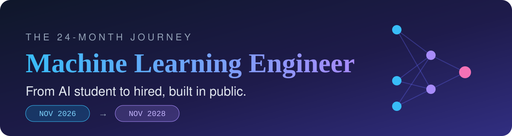
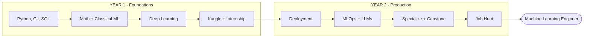
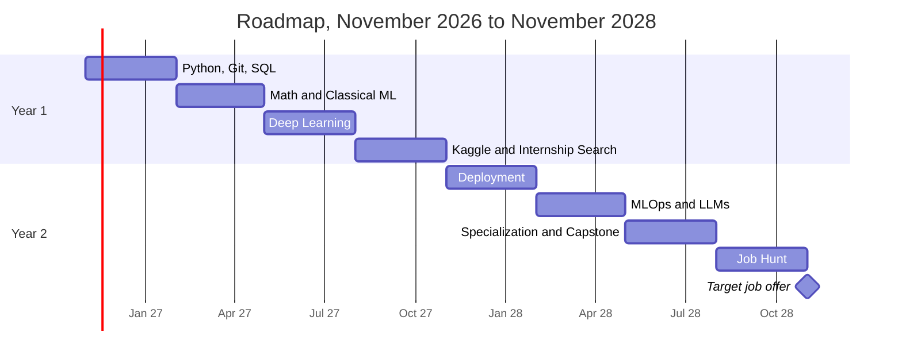
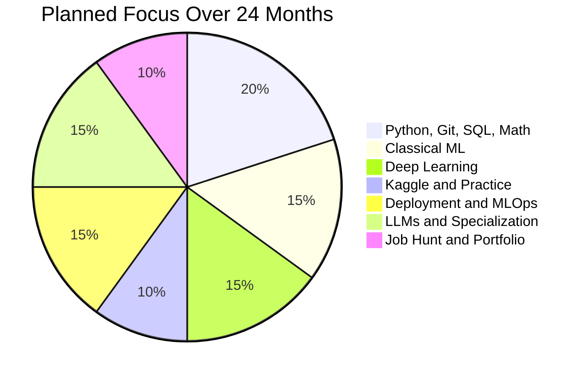

<svg xmlns="http://www.w3.org/2000/svg" viewBox="0 0 1200 320" width="1200" height="320" role="img" aria-label="Machine Learning Engineer Roadmap, November 2026 to November 2028" xmlns:c2pa="http://c2pa.org/manifest"><metadata><c2pa:manifest>AAAWgmp1bWIAAAAeanVtZGMycGEAEQAQgAAAqgA4m3EDYzJwYQAAABZcanVtYgAAAEdqdW1kYzJtYQARABCAAACqADibcQN1cm46YzJwYTo2NDUzMjAxZi00Zjc2LTQ2MTYtOGQ1Yy02ZWI2ZWExM2ViYTQAAAADl2p1bWIAAAApanVtZGMyYXMAEQAQgAAAqgA4m3EDYzJwYS5hc3NlcnRpb25zAAAAALxqdW1iAAAARGp1bWRjYm9yABEAEIAAAKoAOJtxE2MycGEuaW5ncmVkaWVudC52MwAAAPZYQL4EYBp40+iUdilLj5OyV1ncon38K1sQm2hGHXP8pnME0CJMhXf2E/Zjlr/kdg+2V5XbP2VqiZbVVZBF9Na1Uss=</c2pa:manifest></metadata>
  <defs>
    <linearGradient id="bg" x1="0" y1="0" x2="1" y2="1">
      <stop offset="0%" stop-color="#0f172a"/>
      <stop offset="55%" stop-color="#1e1b4b"/>
      <stop offset="100%" stop-color="#312e81"/>
    </linearGradient>
    <linearGradient id="accent" x1="0" y1="0" x2="1" y2="0">
      <stop offset="0%" stop-color="#38bdf8"/>
      <stop offset="100%" stop-color="#a78bfa"/>
    </linearGradient>
  </defs>
  <rect width="1200" height="320" rx="24" fill="url(#bg)"/>
  <g stroke="#6366f1" stroke-opacity="0.35" stroke-width="2" fill="none">
    <line x1="930" y1="70" x2="1010" y2="130"/><line x1="930" y1="70" x2="1010" y2="210"/>
    <line x1="930" y1="190" x2="1010" y2="130"/><line x1="930" y1="190" x2="1010" y2="210"/>
    <line x1="930" y1="250" x2="1010" y2="130"/><line x1="930" y1="250" x2="1010" y2="210"/>
    <line x1="1010" y1="130" x2="1090" y2="170"/><line x1="1010" y1="210" x2="1090" y2="170"/>
  </g>
  <g fill="#38bdf8"><circle cx="930" cy="70" r="11"/><circle cx="930" cy="190" r="11"/><circle cx="930" cy="250" r="11"/></g>
  <g fill="#a78bfa"><circle cx="1010" cy="130" r="11"/><circle cx="1010" cy="210" r="11"/></g>
  <circle cx="1090" cy="170" r="14" fill="#f472b6"/>
  <text x="60" y="95" font-family="'Segoe UI', Helvetica, Arial, sans-serif" font-size="22" letter-spacing="6" fill="#94a3b8">THE 24-MONTH JOURNEY</text>
  <text x="60" y="170" font-family="Georgia, 'Times New Roman', serif" font-size="64" font-weight="bold" fill="url(#accent)">Machine Learning Engineer</text>
  <text x="60" y="225" font-family="'Segoe UI', Helvetica, Arial, sans-serif" font-size="30" fill="#e2e8f0">From AI student to hired, built in public.</text>
  <rect x="60" y="248" width="150" height="38" rx="19" fill="#0ea5e9" fill-opacity="0.2" stroke="#38bdf8"/>
  <text x="135" y="273" text-anchor="middle" font-family="'Courier New', Consolas, monospace" font-size="18" fill="#7dd3fc">NOV 2026</text>
  <text x="235" y="274" font-family="'Courier New', Consolas, monospace" font-size="22" fill="#94a3b8">&#8594;</text>
  <rect x="270" y="248" width="150" height="38" rx="19" fill="#a78bfa" fill-opacity="0.2" stroke="#a78bfa"/>
  <text x="345" y="273" text-anchor="middle" font-family="'Courier New', Consolas, monospace" font-size="18" fill="#c4b5fd">NOV 2028</text>
</svg>
<div align="center">




<br>


### *"Build more than you watch."*

</div>

---

## 📖 About This Repository

I'm a **Bachelor of AI student** with one goal: become a **Machine Learning Engineer** in 24 months.

This repo is my **public learning log**. It holds my roadmap, monthly journal, notes, project index, and resources, so anyone (including future me and future employers) can see the work behind the goal.

> **Why public?** Accountability. A commit history shows consistency better than any certificate.

| 🎯 Goal | 📅 Timeline | ⏱️ Time budget | 📍 Starting point |
|:--|:--|:--|:--|
| Get hired as a Machine Learning Engineer | **November 2026 → November 2028** | 8-10 hours/week on top of my degree | AI degree + 3 ML projects on GitHub |

---

## 🗺️ The Big Picture



### 📅 Timeline



### 🥧 Where My Time Goes



---

## 📊 Live Progress Tracker

**Overall progress:** 

| # | Phase | Period | Progress | Status |
|:-:|:--|:--|:--|:-:|
| 1 | Python, Git, SQL | Nov 2026 - Jan 2027 | `▓░░░░░░░░░` 10% | 🟨 In progress |
| 2 | Math + Classical ML | Feb - Apr 2027 | `░░░░░░░░░░` 0% | ⬜ |
| 3 | Deep Learning | May - Jul 2027 | `░░░░░░░░░░` 0% | ⬜ |
| 4 | Kaggle + Internship Search | Aug - Oct 2027 | `░░░░░░░░░░` 0% | ⬜ |
| 5 | Deployment | Nov 2027 - Jan 2028 | `░░░░░░░░░░` 0% | ⬜ |
| 6 | MLOps + LLMs | Feb - Apr 2028 | `░░░░░░░░░░` 0% | ⬜ |
| 7 | Specialization + Capstone | May - Jul 2028 | `░░░░░░░░░░` 0% | ⬜ |
| 8 | Job Hunt | Aug - Nov 2028 | `░░░░░░░░░░` 0% | ⬜ |

**Legend:** ⬜ Not started · 🟨 In progress · ✅ Done

> *Update the bars and badge at the end of each month. Each ▓ is 10%.*

---

# 🟦 YEAR 1: Build the Foundation

## Phase 1: Python, Git, SQL `Nov 2026 - Jan 2027`

| Topic | Deliverable | Status |
|:--|:--|:-:|
| Python fluency (functions, classes, files, virtual envs) | 10 small scripts/mini-programs | ⬜ |
| Git and GitHub | This repo + a commit at least 3x/week | 🟨 |
| Data structures and algorithms | 3 easy/medium problems per week | ⬜ |
| SQL basics | Practice queries on a sample database | ⬜ |

🏁 **Milestone:** comfortable writing clean Python and working with Git daily.

## Phase 2: Math + Classical ML `Feb - Apr 2027`

| Topic | Deliverable | Status |
|:--|:--|:-:|
| Linear algebra | Notes + from-scratch NumPy exercises | ⬜ |
| Probability and statistics | Notes + worked problems | ⬜ |
| Basic calculus | Gradient intuition notes | ⬜ |
| NumPy, pandas, Matplotlib | Exploratory data analysis notebook | ⬜ |
| scikit-learn (regression, classification, trees, clustering, CV, metrics) | 3 models compared on one dataset | ⬜ |
| **Project 1** | Polished tabular ML project with README | 🟨 |

🏁 **Milestone:** one end-to-end tabular ML project I'm proud to show.

## Phase 3: Deep Learning `May - Jul 2027`

| Topic | Deliverable | Status |
|:--|:--|:-:|
| Neural network fundamentals (backprop, optimizers, regularization) | Network built from scratch in NumPy | ⬜ |
| PyTorch | Training loop written by hand | ⬜ |
| CNNs for images | Image classifier | ⬜ |
| Sequence models and transformers (intro) | Notes + small text model | ⬜ |
| **Project 2** | Image or text classifier, properly evaluated | ⬜ |

🏁 **Milestone:** train, evaluate, and debug a deep learning model in PyTorch.

## Phase 4: Kaggle + Internship Search `Aug - Oct 2027`

| Topic | Deliverable | Status |
|:--|:--|:-:|
| Kaggle competition #1 | Submission + write-up | ⬜ |
| Kaggle competition #2 | Submission + write-up | ⬜ |
| Feature engineering and model debugging | Notes on what moved the score | ⬜ |
| Internship / research assistant applications | 15+ applications sent | ⬜ |

🏁 **Milestone:** Year 1 complete, with two Kaggle write-ups and applications submitted.

---

# 🟪 YEAR 2: Production Skills and Job Readiness

## Phase 5: Deployment `Nov 2027 - Jan 2028`

| Topic | Deliverable | Status |
|:--|:--|:-:|
| FastAPI | Model served through an API | ⬜ |
| Docker | Containerized app | ⬜ |
| Cloud (pick one: AWS, GCP or Azure) | App running in the cloud | ⬜ |
| **Project 3** | Deployed model with a **live URL** | ⬜ |

🏁 **Milestone:** a model anyone can use through a link.

## Phase 6: MLOps + LLMs `Feb - Apr 2028`

| Topic | Deliverable | Status |
|:--|:--|:-:|
| Experiment tracking (MLflow or Weights & Biases) | Tracked experiments in a project | ⬜ |
| Pipelines, testing, monitoring | Tests + basic monitoring on Project 3 | ⬜ |
| LLMs (embeddings, RAG, fine-tuning basics, evaluation) | Working RAG prototype | ⬜ |
| **Project 4** | LLM-powered app (for example, document Q&A) | ⬜ |

🏁 **Milestone:** I can build, ship, and monitor an ML system.

## Phase 7: Specialization + Capstone `May - Jul 2028`

| Topic | Deliverable | Status |
|:--|:--|:-:|
| Pick one: NLP/LLMs · Vision · Recommenders · Time series | Decision + reasoning in the journal | ⬜ |
| Reproduce one research paper | Repo + write-up | ⬜ |
| Open-source contribution | 1 merged PR (docs or bug fix counts) | ⬜ |
| **Capstone** | Substantial project in my specialization | ⬜ |

🏁 **Milestone:** a flagship project that shows depth.

## Phase 8: Job Hunt `Aug - Nov 2028`

| Topic | Deliverable | Status |
|:--|:--|:-:|
| GitHub polish | 3-4 pinned projects with READMEs, results, live links | ⬜ |
| Resume | One page, focused on projects and impact | ⬜ |
| Interview prep | Coding + ML fundamentals + explaining my projects | ⬜ |
| Applications and networking | 50+ applications, LinkedIn, meetups | ⬜ |

🏁 **Final milestone (Nov 2028):** job offer as a Machine Learning Engineer (or a data/software role leading directly to it).

---

## 🚀 Projects

| # | Project | Skills shown | Status | Link |
|:-:|:--|:--|:-:|:-:|
| 1 | Spotify analysis and popularity prediction | pandas, scikit-learn, EDA | 🟨 | [Repo](https://github.com/AbdulsamadMohamedHussein/spotify-analysis-popularity-prediction) |
| ⭐ | Student performance prediction | Regression, data workflow | ✅ | [Repo](https://github.com/AbdulsamadMohamedHussein/student-performance-prediction) |
| ⭐ | Digital image processing | Python, image processing | ✅ | [Repo](https://github.com/AbdulsamadMohamedHussein/Digital-Inage-Processing-Project) |
| 2 | Image or text classifier | PyTorch, CNNs | ⬜ | Coming soon |
| 3 | Deployed ML model | FastAPI, Docker, cloud | ⬜ | Coming soon |
| 4 | LLM / RAG app | Embeddings, retrieval, evaluation | ⬜ | Coming soon |
| 5 | Capstone | Specialization | ⬜ | Coming soon |

⭐ = work done before the roadmap started.

---

## ✅ Success Metrics

How I'll know the plan is working by **November 2028**:

| Metric | Target | Now |
|:--|:-:|:-:|
| Polished projects with READMEs | 5+ | 0 |
| Projects deployed with a live URL | 2+ | 0 |
| Kaggle competitions entered | 2+ | 0 |
| Internships or equivalent experience | 1+ | 0 |
| Open-source contributions | 1+ | 0 |
| Monthly journal entries | 24 | 0 |
| Commits per week | 3+ | - |
| Applications sent | 50+ | 0 |

---

## 🗓️ My Weekly Rhythm (8-10 hours)

| Day | Focus | Time |
|:--|:--|:-:|
| Mon | Theory (course, math, reading) | 1.5 h |
| Tue | Coding practice (algorithms, SQL) | 1 h |
| Wed | Hands-on project work | 2 h |
| Thu | Theory or notes | 1.5 h |
| Fri | Hands-on project work | 1.5 h |
| Sat | Deep work block (project or Kaggle) | 2 h |
| Sun | Weekly review, push commits, plan next week | 0.5 h |

---

## 📁 Repository Structure

```text
ml-engineer-roadmap/
├── assets/                    # Banner and images
├── journal/                   # One short log per month
│   ├── _TEMPLATE.md
│   └── 2026-11.md
├── notes/                     # My notes by topic
│   ├── 01-python-and-tools/
│   ├── 02-math/
│   ├── 03-classical-ml/
│   ├── 04-deep-learning/
│   ├── 05-deployment-and-mlops/
│   └── 06-llms-and-specialization/
├── projects/                  # Index of all projects
├── resources/                 # Courses, books, papers
├── .gitignore
└── README.md                  # You are here
```

---

## 📓 Monthly Journal

| Month | Focus | Entry |
|:--|:--|:-:|
| Nov 2026 | Setup, Python, Git habits | [Read](journal/2026-11.md) |
| Dec 2026 | *Coming soon* | - |

---

## 🧠 Rules I Follow

1. **Build more than I watch.** Every course gets a project.
2. **Commit weekly.** Consistency beats intensity.
3. **Depth over breadth.** Python, PyTorch and deployment before shiny new tools.
4. **Write it down.** One journal entry per month, no exceptions.
5. **Review every quarter.** Adjust the plan honestly if I'm ahead or behind.
6. **Get real experience.** At least one internship or equivalent.

---

<details>
<summary><b>📚 Core resources (click to expand)</b></summary>

<br>

| Area | Resource |
|:--|:--|
| Math | 3Blue1Brown (Linear Algebra, Calculus), Khan Academy (Statistics) |
| Classical ML | scikit-learn docs and tutorials |
| Deep learning | PyTorch tutorials |
| Practice | Kaggle, LeetCode |
| Deployment | FastAPI and Docker official docs |

</details>

<details>
<summary><b>🔄 How I update this README</b></summary>

<br>

1. Change `⬜` to `🟨` when I start something and to `✅` when it's done.
2. Update the progress bar and the overall badge at the end of each month.
3. Add the month's journal entry and link it in the Monthly Journal table.
4. Update the "Now" column in Success Metrics every quarter.

</details>

---

<div align="center">

**Started:** November 2026 · **Target:** November 2028

*Built in public by [Abdulsamad Mohamed Hussein](https://github.com/AbdulsamadMohamedHussein)*

⭐ Star this repo to follow the journey

</div>
